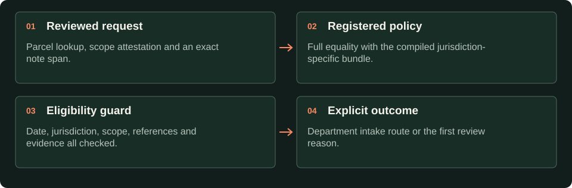
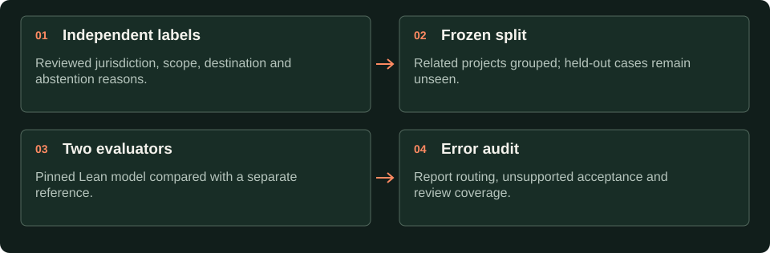

# Jurisdiction before routing: a checked Los Angeles permit-intake model

Evidence binding, explicit abstention and reproducible new-building intake for City and unincorporated County records

**Revanth Matha · Matha Labs | Whitepaper 2.0 | Revised 16 November 2026**

First published 15 November 2026 at 3:12:52 PM PST. Evaluated code: `6b0bbfccbaa7e9f5dd7cafb4768335369b7883b2`.

## Abstract

A construction description can be plausible while naming the wrong permitting authority. This is a practical problem in Los Angeles, where a postal city name does not establish whether a parcel lies within the City of Los Angeles, in unincorporated County territory, or in another incorporated city. We present a small Lean 4 implementation that treats jurisdiction evidence as a prerequisite to routing. A request contains reviewed parcel-lookup evidence, a structured work scope, an exact quotation from an applicant note, model-specific document references and a date. The evaluator compares the complete policy record with a compiled registry and checks every prerequisite before returning either a department intake route or an explicit review reason. Its supported routes are LADBS intake and Los Angeles County Public Works Building and Safety / EPIC-LA intake for unincorporated territory. Fourteen named theorems establish conditions required for successful routing, including that mailing-address-only evidence cannot route. Thirty authored fixtures exercise three successful routes and twenty-seven review cases. These are implementation checks, not a real-project accuracy study. The source interpretation, lookup authenticity, semantic review and completeness of municipal requirements remain external assumptions. This revision explains the algorithm, exact proof scope, rejection behavior, alternative designs and a proposed independent evaluation. The contribution is an inspectable intake boundary under a pinned research model; no output grants a permit, establishes zoning compliance or selects every required agency review.

Keywords: Lean 4, Los Angeles, permit intake, jurisdiction, formal verification, evidence provenance, selective automation

## Contributions

1. A pure evaluator with two supported Los Angeles intake destinations and explicit review for other or unknown jurisdictions.
2. A typed jurisdiction-evidence contract tying the reviewed lookup category, registered source identifier and parcel to the request.
3. Fourteen checked routing invariants and thirty executable synthetic fixtures under Lean 4.35.0.
4. An auditable distinction between model consistency, factual review and municipal approval, with a proposed evaluation protocol.

## 1. The decision that should precede automation

The first useful permitting question is often administrative rather than geometric: which authority should receive this case? A system that confidently identifies a project type but silently assumes the wrong jurisdiction can still waste an applicant's time. County Planning warns that mailing addresses can name an adjacent city even when a property is in unincorporated territory. The published County building-permit guidance separately directs applicants to identify the serving office. These observations motivate a jurisdiction-first research boundary rather than a general permit recommendation. [6][7]

Our research question is precise: given a fixed policy bundle and externally reviewed facts, can a small program make routing reproducible and make its acceptance dependencies inspectable? A successful answer needs both an executable decision and statements about all inputs that can reach it. It also needs a visible refusal path. We therefore include review as a normal result, preserve unsupported jurisdictions in the input type, and avoid an approved-permit constructor altogether. The implementation and its examples are separately inspectable at the pinned source revision. [1][2]

This boundary leaves substantial practical work outside the checker. Choosing an intake authority does not decide whether a design is safe, whether a use is allowed or whether a particular application is complete. That separation is a design constraint with consequences for interfaces: a product should show the route and the checked assumptions together. It should not translate a research routing result into permission to begin construction, even when every encoded predicate is satisfied.


## 2. Two supported authorities and two explicit gaps

The supported City destination is LADBS intake. Its official overview distinguishes permit categories and several plan-review processes. The model does not select express, counter or regular review. City Planning also describes zoning plan check as a distinct review within applicable LADBS applications. We use these sources to identify administrative context, not to infer that the two-route model covers the entire City process. [3][5]

The supported County destination is Public Works Building and Safety / EPIC-LA intake for unincorporated territory. The model does not equate geographic membership in Los Angeles County with eligibility for that route. County-provided services can also exist in incorporated cities, but their individual arrangements are absent from this release. Accordingly, otherIncorporatedCity always requires review even when an applicant believes that County staff might serve the project. [6]

Unknown jurisdiction is a separate input value, not a default to the more common route. Likewise, evidence of a City postal address is not upgraded to boundary evidence. The four-way distinction is operationally useful even before a geospatial integration exists: a caller must represent uncertainty explicitly, and a reviewer can see why a supported destination was withheld. Future contract-city support would need a separate reviewed authority mapping rather than a relaxed generic County rule.

### Table 1. Jurisdiction is a routing precondition

| Reviewed input jurisdiction | Model destination | Boundary of the claim |
| --- | --- | --- |
| cityLA | LADBS intake | Does not choose a plan-review program or grant approval. |
| unincorporatedLACounty | County Public Works / EPIC-LA intake | Applies only to the modeled unincorporated context. |
| otherIncorporatedCity | needsReview | Includes County contract-city arrangements not encoded here. |
| unknown | needsReview | No jurisdiction is inferred from postal wording. |

The four input constructors and two destination constructors are implemented in routeFor. Administrative context comes from official City and County guidance; the exclusions are conservative model scope. [1][3][6]


## 3. Sources establish context, not a complete rule corpus

ZIMAS provides City parcel and zoning information, while County GIS-NET serves unincorporated planning information. Neither a source URL nor the presence of a parcel on a screen is a self-authenticating certificate in this program. The lookupSourceFor registry recognizes authored identifiers for the City ZIMAS context and the County Public Works service-locator context. An upstream reviewer supplies a lookup reference and its interpretation. The evaluator checks identity relationships among those fields, not a live government response. [4][8][9]

EPIC-LA is an application and case-management environment; it is not a replacement for determining which office and process apply. County Planning's portal guidance distinguishes a base application from the later accepted planning case. This matters for software design because a successful login, accepted upload or generated case number should not be substituted for the routing proposition proved here. The prototype performs none of those portal actions. [10]

The sources are reviewed on November 16, 2026, while the compiled model revision remains research-la-snapshot-2026-11-15. These dates describe different activities. The paper's source review does not mutate executable behavior, and the revision identifier is not a digest of all governing documents. We publish source context and code identity separately so a reader can ask whether an observation concerns current guidance, the historical research bundle or a proposed extension.


## 4. Reviewed facts and the evidence contract

A Request contains a jurisdiction, a date, a Scope value, applicant-note text, a quoted Span, review flags and four reference strings: address, parcel, drawings and applicant. The model's DocumentsPresent predicate requires a non-whitespace character in each reference. It does not validate ownership, resolve an assessor identifier, inspect a drawing or verify a professional's license. Calling these references model requirements is important: they are not presented as either agency's exhaustive official checklist. [1]

JurisdictionEvidence contains its source category, source identifier, lookup reference, parcel reference, interpreted jurisdiction and reviewed flag. JurisdictionVerified requires a supported jurisdiction, reviewedOfficialParcelLookup, a true review flag, a matching request parcel and jurisdiction, a nonblank lookup reference and the source identifier registered for that jurisdiction. A record based only on mailingAddressOnly fails even if every other field looks acceptable. These relationships prevent accidental reuse of a reviewed lookup for a different parcel; they cannot stop a dishonest supplier from inventing a matching record.

The scope evidence has a character offset, a positive length and a quotation. Grounded checks bounds and exact equality with the extracted character sequence. The fixture note is the authored string new building, with offset zero and length twelve. This narrow example shows binding without claiming natural-language understanding. A note containing those words in a hypothetical or negative sentence could still satisfy text matching; scopeReviewed is the external attestation that the structured interpretation was reviewed.


## 5. The deterministic guard and its failure order

Eligible is a conjunction of nine groups: complete registered-policy equality, an applicable model date, verified jurisdiction evidence, new-building scope, no retained existing elements, no flagged special conditions, present references, grounded scope evidence and reviewed scope. The policy equality compares the whole record, including jurisdiction, source identifier, revision and interval. A caller cannot extend the interval while keeping the familiar revision and still satisfy that equality. [1]

evaluate first decides eligibility. An eligible request receives the optional route associated with its jurisdiction; otherwise it receives needsReview. The reviewReason function reports the first failing category in a fixed order: policy, date, supported jurisdiction, jurisdiction evidence, scope, retained elements, special conditions, references, quotation and scope review. Reporting one reason is an interface choice, not evidence that no other defect exists. A repair-and-retry interaction could reveal another reason on the next call.

For a fixed compiled environment and the same typed policy and request, this is ordinary deterministic evaluation. It has no network request, model sampler or probability threshold. A language model could propose fields before this boundary, but this release implements no such adapter. Reproducibility therefore requires preserving the reviewed input, not merely saving a human-readable explanation. A changed annotation or policy bundle can correctly produce a different result.

```text
Eligible(p,r) => evaluate(p,r) = routed(routeFor(r.jurisdiction)); otherwise needsReview(firstFailure(p,r))
```

p is the supplied policy and r the reviewed request. Supported jurisdiction evidence ensures routeFor has one of the two modeled destinations. This is a summary of the implemented guard, not a legal applicability equation.

### Figure 1. The implemented checking boundary



A schematic of the actual pure evaluator. Source authenticity and semantic review occur before the checked boundary; municipal approval is downstream and unimplemented. [1]


## 6. Model dates and policy drift

The applicability interval is November 15, 2026, inclusive, through December 1, 2026, exclusive. InWindow first checks that the integer-encoded date is a valid calendar date, then compares it with the interval. The last included fixture is November 30. November 31 is rejected even though its integer representation falls between the endpoints. This demonstrates why a numerical interval alone is not a sufficient calendar check. [1][2]

That interval is a research horizon, not an enactment date or an assertion about grandfathering. Real local applicability may depend on filing events, transitional provisions, geography and project history. City Planning's own explanation notes that different parts of the City can be governed by different zoning-code frameworks during the transition. The model contains no corresponding spatial or vested-rights logic and must not be read as settling those questions. [11]

A credible extension would distinguish source-publication time, source-retrieval time, interpreted rule applicability and evaluation time. It would archive source captures and record the reviewer who authorized each translation. A changed rule should create a new bundle and rerun affected cases rather than silently rewriting an old decision. Those governance mechanisms are proposed here. The present implementation supplies only a compiled registry and explicit interval, so even a correctly rejected stale fixture does not prove that the registry is legally current.


## 7. What fourteen theorem statements establish

The central theorem, routed_requires_eligible, proves that a routed result implies the entire Eligible proposition. routed_uses_registered_policy, routed_within_model_window and routed_requires_jurisdiction expose its policy, calendar and jurisdiction dependencies. routed_requires_supported_scope, routed_excludes_retained_elements and routed_excludes_special_conditions expose the conservative project-scope restrictions. These statements quantify over typed inputs rather than only the examples. [1]

routed_requires_documents, routed_requires_grounded_evidence and routed_requires_reviewed_scope expose reference presence, quotation binding and semantic-review attestation. routed_to_correct_jurisdiction connects the returned destination to routeFor. routed_requires_supported_jurisdiction excludes the other-city and unknown branches. mailing_address_alone_cannot_route proves the named negative property, and ineligible_needs_review characterizes the refusal path. The theorem names are identifiers in the pinned source, not paraphrased marketing claims.

Most of these proofs unfold the explicit guard and project the relevant conjunct. Their value is a reviewable acceptance contract and a regression constraint on future edits; they are not independent demonstrations that every intended real-world requirement was encoded. Lean checks proof terms relative to its environment and foundational assumptions. Neither the kernel nor an absence of project proof placeholders establishes that a jurisdiction attestation is true or that a planning rule was interpreted correctly. [12]


## 8. Worked routing and rejection cases

The base City fixture uses the research date November 15, the newBuilding scope, matching synthetic parcel and lookup references, reviewed flags, the exact twelve-character note span and four nonblank model references. With policyFor cityLA, evaluate returns routed laLADBS. Changing the supported jurisdiction and its matching lookup context to unincorporatedLACounty produces routed laCountyPublicWorksEPICLA. Neither example contains a real property or government lookup result. [2]

The most informative mutations preserve plausibility while breaking a dependency. Supplying the County policy for the City request returns untrustedPolicy. Retaining a City request but changing the lookup's parcel returns missingJurisdictionEvidence. Changing its source category to mailingAddressOnly also returns that review category. Unsupported ordinary repairs return unsupportedScope, which is a refusal to classify this case rather than a decision that repair work is exempt.

There are thirty executable cases: three routed outputs and twenty-seven review outputs. The third routed case is the last included date. Other mutations cover unknown or unsupported jurisdiction, an invented revision, extended interval, invalid calendar day, missing references, whitespace-only address, retained elements, special conditions and fabricated, empty or out-of-bounds spans. These cases are named input mutations with expected outputs. Their pass rate says nothing about how often real projects will be routed correctly.

### Table 2. Concrete fixtures and expected outcomes

| Mutation of the reviewed City fixture | Expected result | Meaning |
| --- | --- | --- |
| No mutation; registered City policy | routed laLADBS | All modeled prerequisites hold. |
| Matching unincorporated County record and policy | routed laCountyPublicWorksEPICLA | Separate authority, separate lookup context. |
| County policy supplied for City request | needsReview untrustedPolicy | Whole-record identity fails. |
| Mailing-address-only evidence | needsReview missingJurisdictionEvidence | Postal wording cannot replace reviewed lookup evidence. |
| onDate = 20261131 | needsReview outsideModelWindow | Calendar validity fails before routing. |
| scope = ordinaryRepair | needsReview unsupportedScope | No permit-exemption conclusion is issued. |

These outcomes are directly exercised in Main.lean. All references and applicant text are authored fixtures. The table is a subset of thirty cases, not a field-performance benchmark. [2]


## 9. Alternative approaches and related research

A spreadsheet or conventional rules engine can implement the same guard and may be easier for domain staff to edit. A general-purpose typed application can also represent reviewed facts and refusal states. Lean adds machine-checked propositions about every routed value, but that benefit carries the cost of maintaining formal definitions and proving that revised code preserves the intended contract. Choosing Lean is justified here by inspectability and proof experimentation, not by evidence of faster municipal processing.

An end-to-end language-model answer can handle more varied prose, while a retrieval system can locate current guidance. Both remain useful upstream options. Neither automatically supplies the exact typed relationships required here. Conversely, our exact string span is intentionally weaker than an entailment model: it verifies occurrence, not meaning. A hybrid comparison should therefore evaluate extraction and routing separately instead of reporting one undifferentiated accuracy figure.

Catala studies executable computational law with a language designed around legal rule structure; its published work supplies a relevant alternative emphasis on rule translation and exceptions. Lexifina's article supplies the certificate-checking architectural inspiration. Our implementation reuses neither system's corpus, code nor claimed measurements. Its distinctive object is a very small Los Angeles intake guard whose external assumptions can be examined without a full legal-text pipeline. [13][14]


## 10. Residual risks and unimplemented decisions

The largest residual risk is a consistent but false input. A supplier can mark a nonexistent lookup reviewed, attach a nonblank reference and claim that special conditions are absent. The checker will validate relationships among those fields without discovering the deception. Evidence authentication, reviewer authority, conflicting records and an audit trail for changes require additional mechanisms. Even an honest reviewer can misunderstand a boundary or miss a project feature; the formal result does not transfer responsibility for that interpretation to Lean.

The model does not calculate setbacks, height, floor area, occupancy, accessibility, structural performance, fire requirements, environmental review, fees, trade permits, inspections or professional qualifications. The retained-elements and special-conditions flags are coarse conservative gates, not substitute engineering or planning classifications. Nor does routing establish that a file satisfies an agency's completeness requirements. A deployment would need authoritative source coverage and domain review before adding any of those decisions.

Public sources can also disagree in detail or change their interfaces independently of the underlying law. An output should therefore identify both its model revision and the evidence used, display unresolved facts and make escalation straightforward. No pilot applicant outcomes, processing-time savings, acceptance precision, calibration estimate or adversarial robustness result is reported here. These missing observations are constraints on interpretation of the release, not measurements inferred from the fixture count.


## 11. A proposed independent evaluation

The next study should start with a frozen scope definition and separately reviewed project files. Two qualified reviewers should label jurisdiction, supported work scope, the appropriate modeled intake destination and reasons for abstention; disagreements should be adjudicated before the checker is scored. A time-separated set should be held back while rules are developed. Contract-city cases, postal-name ambiguities and incomplete records should be deliberately represented instead of excluded as inconvenient edge cases.

Report correct routing among supported cases, unsupported cases incorrectly routed, missed escalation conditions and the fraction requiring review. Provide numerators and denominators for each jurisdiction and ambiguity stratum. Measure evidence-binding failures separately from jurisdiction interpretation and rule-encoding errors. If multiple files concern one parcel or project, keep those related files in the same partition to prevent leakage. These are proposed evaluation requirements; the release contains no such corpus or measured rates.

An independent reference implementation should be written from the reviewed rule specification rather than translated line by line from Lean. Differential testing can then compare decisions and review reasons, while mutation tests challenge each dependency. Review false acceptances first, preserve the complete input and revision for replay, and publish the limits of inter-reviewer agreement. This design would make a larger coverage claim assessable without confusing a large number of automatically generated cases with independent legal evidence.

### Figure 2. Proposed field-evaluation design



A proposed protocol, not an executed study. No project corpus, independent comparator or performance number is supplied by this release.


## 12. Reproduction and the next bounded extension

The code identity for this paper is commit 6b0bbfccbaa7e9f5dd7cafb4768335369b7883b2 in lean-city-permitting. The project pins leanprover/lean4:v4.35.0, imports Std and uses no additional Lean package. lake build checks the declarations and builds the fixture executable; lake exe fixtures compares the thirty actual and expected decisions; sh scripts/check-proof-holes.sh scans the authored Lean files. A successful source scan complements proof checking and does not establish specification completeness. [1][2]

The paper revision changes the explanation and source review, not that executable scope. Reproducing a fixture needs the policy and complete typed request as well as the pinned source. Reproducing a real administrative recommendation would additionally need its external evidence, provenance and reviewed applicability assumptions. Those artifacts should be retained separately so later source updates do not erase what a historical decision actually depended on.

A sensible next extension is one additional Los Angeles work type or one explicitly reviewed contract-city arrangement, with source interpretation, exceptions and escalation cases added together. Increasing the number of jurisdictions before validating the local evidence contract would weaken the meaning of the result. The present release gives a concrete starting point: two named destinations, a total refusal path and a small proof surface that can be challenged openly before a broader operational claim is made.

## Scope

The implementation routes reviewed new-building research fixtures in City Los Angeles or unincorporated Los Angeles County. It does not authenticate GIS evidence, implement municipal codes, determine permit exemptions, submit applications or grant approval; other incorporated cities, including County contract-city cases, require review.

## References

[1] [Matha Labs, lean-city-permitting: checked model](https://github.com/RevanthM/lean-city-permitting/blob/6b0bbfccbaa7e9f5dd7cafb4768335369b7883b2/CityPermitting.lean). Pinned executable definitions: JurisdictionVerified, Eligible, reviewReason, evaluate and fourteen named theorems. Accessed 2026-11-16.

[2] [Matha Labs, lean-city-permitting: executable fixtures](https://github.com/RevanthM/lean-city-permitting/blob/6b0bbfccbaa7e9f5dd7cafb4768335369b7883b2/Main.lean). baseRequest and cases: thirty authored cases, including City/County routing, mailing-only refusal and calendar boundaries. Accessed 2026-11-16.

[3] [LADBS, Plan Review & Permitting](https://dbs.lacity.gov/services/plan-review-permitting). Sections Types of Permits, Types of Plan Review and Obtaining Clearance Approval from Other City Departments & Agencies; administrative context only. Accessed 2026-11-16.

[4] [LADBS, Zoning](https://dbs.lacity.gov/services/zoning). Zoning Online Research, ZIMAS subsection: City parcel and zoning-information context. Accessed 2026-11-16.

[5] [Los Angeles City Planning, Zoning Review](https://planning.lacity.gov/project-review/zoning-review). Zoning Plan Check discussion: applicable LADBS applications route to City Planning via ePlanLA; separates zoning from other plan-check elements. Accessed 2026-11-16.

[6] [Los Angeles County Public Works, Building and Safety](https://permits.lacounty.gov/permits/building-and-safety/). Who Issues the Permit?; Office Locations; Apply for a Building Construction Permit, Steps 1-3; unincorporated authority and service-locator/EPIC-LA context. Accessed 2026-11-16.

[7] [LA County Planning, Unincorporated Los Angeles County](https://planning.lacounty.gov/unincorporated-los-angeles-county/). Are We Your Planning Department? subsection: mailing-address ambiguity and jurisdiction lookup. Accessed 2026-11-16.

[8] [LA County Planning, GIS-NET PUBLIC](https://planning.lacounty.gov/maps-and-gis/gis-net-public/). Introduction and Key Features: unincorporated planning information and address/AIN-based tools; no dataset imported. Accessed 2026-11-16.

[9] [Los Angeles County Public Works, Service Locator](https://pw.lacounty.gov/general/servicelocator/). Official lookup destination linked by County Building and Safety Step 1. The model authenticates no live lookup response. Accessed 2026-11-16.

[10] [LA County Planning, EPIC-LA](https://planning.lacounty.gov/epic-la/). Register, Apply and Search sections: portal functions and distinction between base application and accepted planning-case identifiers. Accessed 2026-11-16.

[11] [Los Angeles City Planning, How do I determine the zoning for a property?](https://zoning.lacity.gov/index.php/faq/general-questions/how-do-i-determine-zoning-property). Important Notes: Original and New Zoning Code applicability can differ by area during transition; that logic is unimplemented. Accessed 2026-11-16.

[12] [Lean project, Theorem Proving in Lean 4: Axioms and Computation](https://lean-lang.org/theorem_proving_in_lean4/Axioms-and-Computation/). Chapter discussion of proof checking, axioms and computation; explains formal guarantees relative to assumptions. Accessed 2026-11-16.

[13] [Merigoux, Chataing and Protzenko, Catala: A Programming Language for the Law](https://arxiv.org/abs/2103.03198). 2021 paper, revised July 2, 2021; abstract and language-design motivation for executable computational law. No implementation or benchmark reused. Accessed 2026-11-16.

[14] [Lexifina, Formalizing all US case law in Lean](https://lexifina.com/blog/formalizing-all-us-case-law-in-lean). November 13, 2026; Section 2, Nothing is taken on trust, motivates evidence certificates and a separate checker. Vendor results are not reproduced here. Accessed 2026-11-16.
